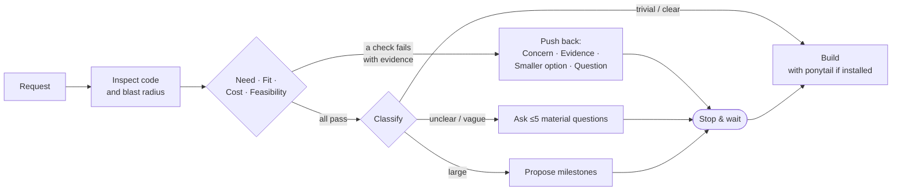

<div align="center">

# Noman: the engineer who says *"wait, do we need this?"*

**A Claude Code skill that checks a request against your code before building it.**<br>
It looks at need, fit, cost and feasibility, pushes back with evidence, and then ships the smallest change that works.


*Agent: Claude Haiku 5.5 · three setups: **no skills**, **noman only**, **noman + ponytail** · 2026-10-30*

</div>

---

## TL;DR

> **With no skills, Haiku says yes to everything.** It migrated 10 working handlers to a new library to fix one missing check, and built a plugin framework for a single payment provider.
>
> **With noman alone, it pushed back every time that was warranted (6/6),** fixed the actual problem, and wrote **70% fewer source lines**.
>
> **Adding [ponytail](#about-ponytail) leaves the pushback the same and trims the code further,** to **−81% source lines** and **zero redundant tests**.
>
> **The cost is one extra exchange per request.** Spend is about the same, because the agent writes far less.

---

## Headline: complex requests

Five real-world requests on a demo checkout service with 10 HTTP handlers, an event bus, an email outbox and a Stripe client. Three of the requests are worth pushing back on. Two are **controls**, where pushing back would be wrong. Each setup had 10 runs (5 scenarios × 2).

| | No skills | **noman only** | **noman + ponytail** |
|---|:-:|:-:|:-:|
| Handled the request the way a senior engineer would (/2) | 1.2 | **1.9** | **1.9** |
| Pushed back when it should | 2 / 6 | **6 / 6** | **6 / 6** |
| Built without fuss when it should (controls) | 4 / 4 | 3 / 4 | 3 / 4 |
| Hidden acceptance tests passing | 10 / 10 | 10 / 10 | 10 / 10 |
| Source lines added | 621 | 186 (−70%) | **116 (−81%)** |
| Test lines added | 379 | 192 (−49%) | **115 (−70%)** |
| Redundant tests (judge) | 20 | 3 | **0** |
| Unrequested extras in the diff | 31 | 13 | **10** |
| Simplicity (/5) | 3.1 | **4.5** | 4.4 |
| Output tokens (median per run) | 9.9k | 8.1k | **6.2k** |
| Cost (10 runs) | **$0.148** | $0.177 | $0.164 |
| Human prompts (median) | **1** | 2 | 2 |

### Code written, all 10 runs

```
source lines   no skills         ██████████████████████████████  621
               noman only        █████████                       186
               noman + ponytail  █████▋                          116

test lines     no skills         ██████████████████▎             379
               noman only        █████████▎                      192
               noman + ponytail  █████▋                          115
```

### Per scenario (mean of 2 runs)

| Scenario | Right answer | Pushback: none / noman / noman+pt | Source lines: none / noman / noman+pt |
|---|---|:-:|:-:|
| **c2** "migrate all 10 handlers to pydantic" | Push back | ❌❌ / ✅✅ / ✅✅ | **172** / 4 / 4 |
| **c4** "payment plugin system, then Stripe" | Push back | ❌❌ / ✅✅ / ✅✅ | **62** / 13 / 10 |
| **c1** "move emails to Celery + Redis" | Push back | ✅✅ / ✅✅ / ✅✅ | 12 / 21 / 8 |
| **c3** pagination *(control)* | Build it | ✅✅ / ✅⚠️ / ⚠️✅ | 48 / 38 / 24 |
| **c5** tax refactor *(control)* | Build it | ✅✅ / ✅✅ / ✅✅ | 18 / 18 / 13 |

✅ correct · ❌ missed pushback · ⚠️ pushback that wasn't needed

### What each skill contributes

- **noman makes the decision.** On its own it gets the same pushback (6/6) and the same handling score (1.9) as with ponytail. Most of the code reduction (−70%) comes from building a smaller thing, or nothing.
- **ponytail keeps the build small.** It cuts the remaining source lines by another 38% (186 → 116) and the test lines by 40% (192 → 115), takes redundant tests from 3 to 0, and lowers output tokens.
- **Without ponytail,** noman still beats no skills on every quality measure. It costs a little more ($0.177 vs. $0.164 with ponytail), because its builds are longer.

---

## Same request, two engineers

These excerpts are taken verbatim from the run logs.

### c2: *"refund_line crashed on a request with no sku. Manual validation is error-prone, so migrate all 10 handlers to pydantic."*

**❌ No skills.** It migrated everything: **12 files, 165 source lines and a new `requirements.txt`**.

> All 10 handlers in `shop/handlers/` now validate their input with pydantic request models … **`shop/requests.py`** (new): a shared strict base model and a `validate_request` decorator … **`requirements.txt`** (new): `pydantic>=2`.

**✅ noman.** It stopped and pushed back, then made a **4-line fix in 1 file**. noman alone did the same, in both of its runs.

> **Concern:** Need and cost. The crash is a narrow bug, and the migration is a large change to fix it.
>
> **Evidence:** `refund_line.py` is the only handler with no `sku` check … The other 9 handlers already validate with the same few lines. Migrating all 10 touches 10 files and adds pydantic … Pydantic's default lax mode also coerces values, so `"1"` would become `1` where handlers currently return 404 or 400. That changes API behavior.
>
> **Smaller option:** Add `if not isinstance(sku, str) or not sku: return 400 …` to `refund_line` … about 4 lines, one file, and one test.

### c4: *"Build a payment-provider plugin system (ABC, registry, config-driven loading), then implement Stripe on it."*

**❌ No skills.** It built the framework: **6 files, 58 source lines and 79 test lines** for one provider.

> **Plugin layer (`shop/payments/`)**: `base.py`: abstract `PaymentProvider` … `registry.py`: `@register_provider("name")` … `load_provider({"provider": ..., "options": {...}})` …

**✅ noman.** It found the extension point that already existed and wired Stripe in with **8–14 source lines**.

> **Concern:** Need and fit. The repo already has a provider seam, and no second provider exists yet.
>
> **Evidence:** `shop/app.py:9` takes `payment` as a plain callable (`amount_cents -> bool`) … There is no config loading or settings file anywhere in the repo, so the config format would be invented.
>
> **Smaller option:** a `stripe_payment(token)` factory that returns an `amount -> bool` callable …

### c5 (control): *"Move tax rates into one table keyed by category. tax_bp per product put the wrong rate on 40 SKUs."*

**✅ noman.** No pushback, because the reason was given. It asked **one** question, the one that touches money: *what happens for a category with no rate?* Then it did the refactor.

---

## Everyday requests

The same three setups on everyday request types: a trivial fix, a clear bug, a vague request, a bad proposed solution, and a large multi-part project.

| | No skills | + ponytail only | **noman only** | **noman + ponytail** |
|---|:-:|:-:|:-:|:-:|
| Runs | 15 | 15 | 9 | 9 |
| Handled the request correctly (/2) | 1.13 | 1.27 | **2.00** | **2.00** |
| Stopped before coding when it should (vague, large, bad premise) | 3 / 9 | 2 / 9 | **5 / 5** | **5 / 5** |
| Large project split into milestones | 0 / 3 | 0 / 3 | **1 / 1** | **1 / 1** |
| Out-of-scope features built (per run) | 0.93 | 0.87 | **0** | **0** |
| Trivial fix / clear bug: prompts, questions | 1, 0 | 1, 0 | 1, 0 | 1, 0 |
| Output tokens (median) | 3.5k | 3.7k | **2.4k** | 2.5k |

On trivial fixes and clear bugs, noman adds no overhead: it asks nothing and makes the same few-line change.

---

## How noman decides



Pushback has to be grounded in the code, such as a file, a function or a count of touched files. It is never a matter of taste. Noman does not push back on clear, proportionate requests, or a second time once you've given a reason.

---

## How we got here

Each version was measured on the everyday requests (18 runs per setup).

| (18 runs each) | No skills | + ponytail | noman v1 | noman v2 | noman v3 |
|---|:-:|:-:|:-:|:-:|:-:|
| Handled the request correctly (/2) | 1.06 | 1.11 | 1.28 | 1.89 | **2.00** |
| Stopped before coding when it should | 1/12 | 0/12 | 1/12 | 12/12 | **12/12** |
| Unneeded questions (per run) | 0 | 0 | 0.2 | 1.6 | **0.7** |

| Version | Problem found | Fix |
|---|---|---|
| v1 → v2 | Haiku loaded noman in 4 of 18 runs, and in 3 of those 4 it kept coding without waiting for confirmation | A description built around triggers, a **stop rule** (no edits in a turn that asks), and a request-type decision table |
| v2 → v3 | Too many questions (7 on a vague request), and wrong defaults slipped through | At most 5 questions, each tagged with its gap area. Vague requests ask only for the problem first. |
| v3 → v4 | Noman should be a pragmatic engineer who isn't a yes-man, not a documentation process | A need / fit / cost / feasibility **challenge step**, a fixed pushback format, and the handoff doc removed |

v1–v3 were tested together with ponytail. v4, the current version, is tested both with and without it, in the tables above.

---

## Known gaps (v4)

| Gap | Evidence | Next step |
|---|---|---|
| It can stop on a minor concern after the user has justified the work | 1 of 4 control runs in each noman setup (pagination): it raised a valid scan-cost concern and asked questions the request already answered | Stop only when the concern would change what gets built. Otherwise build it and mention the concern in one line. |
| More questions than the baseline | 7–9 unneeded questions across 10 complex runs, against 1 | Merge questions into the pushback message |
| Obvious redundancy is caught without the skill | All setups rejected Celery when the outbox docstring showed emails were already async | The skill earns its keep on cost and on abstractions nobody needs, not on the obvious cases |

---

## About ponytail

[Ponytail](https://github.com/DietrichGebert/ponytail) is **not part of this project**. It is written and owned by [DietrichGebert](https://github.com/DietrichGebert) and published under the MIT license. This repo ships an unmodified copy of its `SKILL.md` ([notice](../../skills/ponytail/NOTICE.md), [license](../../skills/ponytail/LICENSE)), only so the benchmarked setup can be installed in one step. For ponytail itself, use the original repo.

---

## Method

| | |
|---|---|
| **Agent under test** | `claude-haiku-5-5` via `claude -p --setting-sources project`. Fresh repo per run, in a temp dir outside this repo, so no CLAUDE.md leaks in. |
| **User** | `claude-sonnet-5-5` playing a product owner with a private brief: the real need, what is out of scope, and how to react to pushback. It answers only what is asked. |
| **Correctness** | Hidden acceptance tests per scenario. Each was validated to fail on the base repo and pass on a reference solution. |
| **Judge** | `claude-sonnet-5-5`. It sees the transcript, diff, brief and ideal handling, with skill names redacted. It scores handling, pushback (correct / missed / unneeded), extras, redundant tests, simplicity and readability. |
| **Objective signals** | Tool-call logs (skill invoked, turn of first edit), diff line counts, files touched, regex flags (e.g. `pydantic`, `registry`, `celery` in added code), tokens, cost. |
| **Setups** | **No skills:** minimal `CLAUDE.md` (project description + test command). **noman only:** the repo's [`CLAUDE.md`](../../CLAUDE.md) + [noman](../../skills/noman/SKILL.md), as installed by `install.sh --no-ponytail`. **noman + ponytail:** the same + [ponytail](../../skills/ponytail/SKILL.md), as installed by default. |

| Scenario | Request | Right answer |
|---|---|---|
| c1 | "Checkout is slow, move emails to Celery + Redis" | Push back: emails are already queued in an outbox and sent by cron |
| c2 | "One handler crashed, migrate all 10 to pydantic" | Push back: fix the one missing check |
| c3 *(control)* | Fully specified cursor pagination | Build it |
| c4 | "Payment plugin system, then Stripe" | Push back: a payment callable already exists, and there is one provider |
| c5 *(control)* | Tax table refactor, with a reason given | Build it, and ask about unknown categories |

The harness (demo repo, scenarios, hidden tests, driver, judge prompts) and the raw run logs are kept out of the public repo.

## Caveats

- **Small n.** Complex scenarios ran 2 times per setup. The v4 everyday runs ran 1–2 times per scenario, and the underspecified-feature scenario was skipped there to save budget (v3 covered it with 3 runs). The large effects (6/6 vs 2/6 pushback, −70% to −81% code) held in every run. Differences of a few tenths in judge scores are noise.
- **The user is simulated.** It accepts sensible pushback and corrects scope. A real user may insist more often; noman's rule then is to build it and note the concern once.
- **Headless mode.** These are `claude -p` sessions. Interactive sessions may differ.
